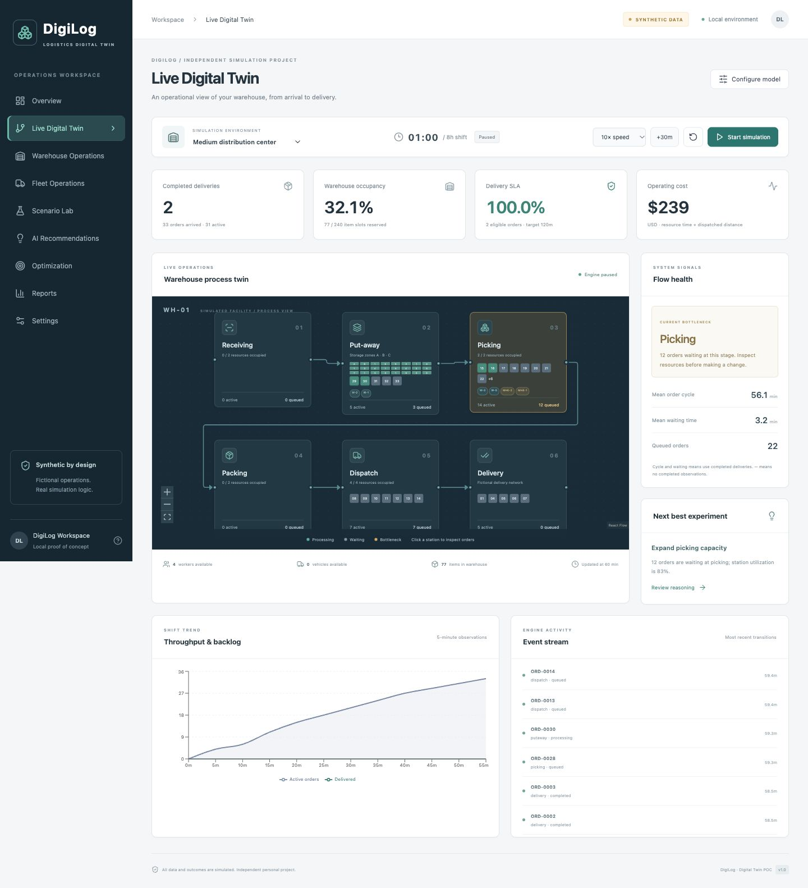

# DigiLog — Logistics Digital Twin

An independent personal project for exploring logistics operations with discrete-event simulation and explainable decision support. **All inputs and outcomes are synthetic. No company affiliation, proprietary data, logos or internal systems are involved.**

DigiLog turns a warehouse-and-fleet model into a working experiment loop: observe a bottleneck, change resources, compare paired simulations, inspect the trade-off, and export evidence. No paid API, LLM, external account or cloud subscription is required.



## Run locally

Requires Python 3.12+ and Node.js 22+ with npm. Tested here with Python 3.14 and Node 24 on macOS. Installation downloads open-source dependencies; the running application uses local services only.

```bash
./scripts/setup.sh
./scripts/dev.sh
```

Open [DigiLog](http://127.0.0.1:5173) and [local API documentation](http://127.0.0.1:8000/docs). Stop both services with Ctrl-C. Each service binds to 127.0.0.1. Use one backend worker. If a port is already occupied, stop the prior service first.

Or start the two services in separate terminals from the repository root:

```bash
PYTHONPATH=backend .venv/bin/python -m uvicorn digilog.main:app --host 127.0.0.1 --port 8000
npm --prefix frontend run dev
```

The frontend proxies `/api` to port 8000. Do not open index.html directly. Backend CORS allows only localhost/127.0.0.1 port 5173. Start without `--reload` for stable in-memory simulations; restarting the backend loses active run state.

## Implemented

- React / TypeScript / Vite, Tailwind and a shadcn-style Radix/CVA Button; Recharts and React Flow visualizations.
- FastAPI / Pydantic REST API, OpenAPI with bundled offline Swagger UI, SimPy finite-resource simulation, NumPy confidence summaries, Pandas CSV, SQLite artifacts.
- Three synthetic environments, receiving → put-away → picking → packing → dispatch → delivery, finite item storage, shared workers, station/equipment constraints and identity assignments.
- Start, pause/resume, seeded reset, speed control and +30-minute step. Live metrics and order tokens come from actual backend state, never a second frontend simulation.
- Capacity-constrained fleet batches, loading, fictional distances, variable travel, downtime, unloading and vehicle return.
- Eight built-in scenarios, saved custom scenarios, paired-seed comparisons, multiple replications, means and conservative 95% Student-t intervals.
- Evidence-backed rules, bounded configuration search, cost objective and explicit lower-confidence-bound SLA constraint.
- CSV current-run export, printable report, comparison/optimization JSON and local saved experiment history.

## Tests and validation

```bash
./scripts/test.sh
# With the backend already running, exercise the live frontend/API contract too:
DIGILOG_API=http://127.0.0.1:8000/api npm --prefix frontend test
```

Automated coverage includes reproducibility, incremental stepping, resource limits, item conservation, order lifecycle, fleet assignment, overdue-order SLA, exact metric arithmetic, controlled resource improvement, paired comparisons, interval handling, optimization feasibility, API validation, job failure status, report export and frontend-visible metric contracts. The live API contract test skips when DIGILOG_API is absent; backend integration tests still run independently.

See `docs/VALIDATION.md` for the actual execution record. Docker support is provided but is only marked tested there if a Docker daemon was available.

## Docker

```bash
docker compose up --build
```

Open [DigiLog in Docker](http://127.0.0.1:8000). The image builds the frontend and serves it through FastAPI. Compose publishes only 127.0.0.1:8000; container-internal 0.0.0.0 does not make it public. SQLite persists in the named volume. No telemetry is configured. Do not expose this unauthenticated POC publicly.

## Synthetic dataset generator

```bash
PYTHONPATH=backend .venv/bin/python -m digilog.generate --preset small --output synthetic-small.json
```

Presets: small, medium, high. The output includes fictional products, zones, staff, equipment, vehicles, destinations, orders, delivery jobs, costs, events and inventory state. Default database is `digilog.sqlite3` in the process working directory; override with DIGILOG_DB. Set DIGILOG_FRONTEND to a built frontend directory for single-process static serving. Do not commit generated databases or datasets.

## Project structure

```text
backend/digilog/  simulation, validation, data, analysis, API, persistence
backend/tests/    engine invariants and API integration tests
frontend/src/     application, live twin, typed REST client, components, tests
docs/             architecture, assumptions, demo, roadmap and validation
scripts/          setup, local development and tests
Dockerfile        multi-stage build, non-root runtime
compose.yaml      localhost-only published port and SQLite volume
```

Read [architecture](docs/ARCHITECTURE.md), [assumptions and metric definitions](docs/ASSUMPTIONS.md), [demonstration guide](docs/DEMO_GUIDE.md), and [roadmap](docs/ROADMAP.md).

## Scope and limitations

This is a process twin, not a calibrated spatial warehouse or real route optimizer. Costs are fictional; short horizons and completed-order averages can mislead without backlog/SLA context. No warm-up/drain, SKU replenishment, trained predictive model or enterprise connector is included. Optimization is a bounded search and needs independent seed validation. Active runs/jobs are in memory and cannot resume after restart; SQLite retains scenarios, completed snapshots and experiments. Historical live-run snapshot browsing is not exposed. Print is supported; native PDF export is not implemented. Authentication and distributed job isolation are future work.

## Publishing your repository

This folder is a standalone Git-ready project. Review the MIT license and README, then initialize Git and commit the source. `.gitignore` excludes dependencies, databases, local environments and credentials. No remote is configured and nothing is published automatically.

```bash
git init
git add .
git commit -m "Build DigiLog logistics digital twin"
```
