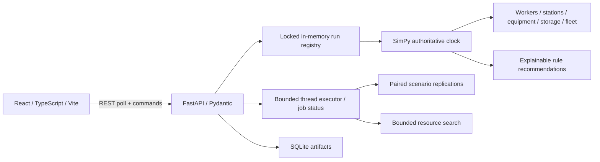

# Architecture

DigiLog is an independent personal logistics simulation project. All inputs and outcomes are fictional.

`backend/digilog/schemas.py` validates inputs and defines demo environments. `data.py` generates products, zones, synthetic staff/equipment/vehicle identities and fictional destinations. `engine.py` owns event scheduling, entities, resource allocation and metric collection. `analysis.py` owns comparisons, confidence intervals, rules and optimization. `store.py` persists custom scenarios, completed run snapshots and experiments. `main.py` exposes REST, job state, CSV and offline OpenAPI UI.

The frontend polls actual snapshots every 800 ms. The backend ticker advances each running SimPy environment every 250 ms by speed × 0.25 simulated minutes. Run controls and reads share an RLock. Resource capacities are immutable within a run. Reconfiguration creates a fresh run; reset recreates the same seeded environment. Frontend order tokens are derived from actual order stages. Vehicle positions interpolate only between backend trip timestamps. This is a process twin, not a geometric warehouse travel model.

The engine follows SimPy's numeric `run(until=...)` convention: events exactly at the horizon are excluded. Time has a single authoritative owner, `Environment.now`. See [SimPy environment documentation](https://simpy.readthedocs.io/en/latest/topical_guides/environments.html).

Two experiment threads run independently of the live registry. Queue admission is capped at four outstanding jobs; status is queued/running/completed/failed. CPU-bound work still shares the Python interpreter; it is suitable for this bounded local POC, not distributed heavy workloads. This follows the separation of long-running work discussed in [FastAPI background task guidance](https://fastapi.tiangolo.com/tutorial/background-tasks/).

SQLite saves JSON artifacts with parameterized SQL. Live SimPy generators cannot be resumed after a process restart. Completed snapshots persist, but historical live-run browsing is not yet exposed in the UI; experiment downloads and custom scenarios are exposed. Run registry is capped at 30 and evicts a non-running run when necessary. Job registry is process-local. Run one API worker. There is no multi-user session ownership or authentication.

Runtime browser traffic is localhost-only: no remote fonts, map tiles, analytics, CDN scripts or model calls. Swagger UI assets are bundled. Development servers bind to localhost. Docker listens on all interfaces inside its container but publishes only on host 127.0.0.1. Dependency installation requires internet access.
